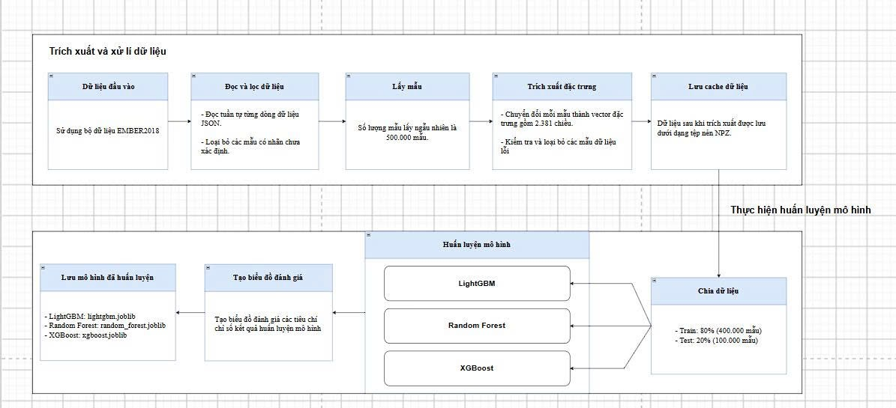
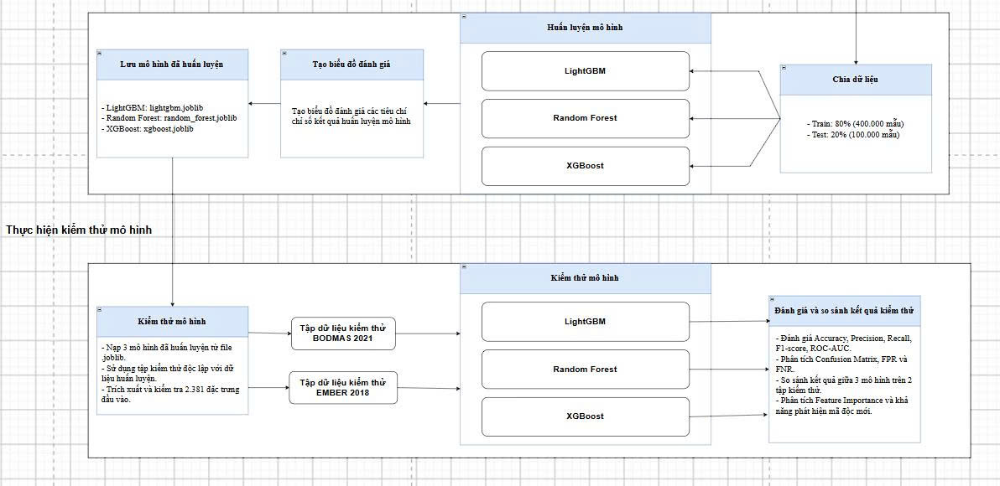

# Phát hiện mã độc Windows PE bằng Machine Learning

Đề tài **“Nghiên cứu ứng dụng Học máy trong việc phát hiện file thực thi độc hại Windows PE”** sử dụng đặc trưng tĩnh của file PE để phân loại **lành tính (Benign)** và **mã độc (Malware)** bằng ba thuật toán: **LightGBM, Random Forest và XGBoost**.

Trọng tâm thực nghiệm là **huấn luyện trên EMBER2018** và kiểm thử độc lập trên **EMBER2018 Official Test** cùng **BODMAS**. Mô hình được kiểm thử lại từ file `.joblib`, **không huấn luyện lại trên tập test**.

## 1. Dữ liệu sử dụng

| Bộ dữ liệu | Vai trò | Tệp sử dụng | Đặc trưng | Thông tin chính |
|---|---|---|---|---|
| **EMBER2018** | Train / Validation | `train_features_0.jsonl` đến `train_features_5.jsonl` | EMBER v2 — **2.381 chiều** | Lấy ngẫu nhiên tối đa **500.000 mẫu có nhãn** từ phần train; chia **80% Train / 20% Validation** |
| **EMBER2018 Official Test** | **Test chính thức** | `test_features.jsonl` | EMBER v2 — **2.381 chiều** | Là tập test riêng do EMBER cung cấp; không nằm trong cache train và không dùng để chọn ngưỡng |
| **BODMAS** | **External Test** | `bodmas.npz`, tùy chọn `bodmas_metadata.csv` | **2.381 chiều** theo hệ đặc trưng EMBER | **134.435 mẫu** (77.142 lành tính, 57.293 mã độc), thu thập **08/2019–09/2020** |

**Quy ước nhãn:** `0 = Benign`, `1 = Malware`; các mẫu EMBER2018 có nhãn `-1` hoặc không hợp lệ được loại khỏi quá trình lấy mẫu/kiểm thử theo script.

**Nguồn dữ liệu:**
- EMBER2018 Feature Version 2: https://github.com/elastic/ember — tệp dữ liệu: https://ember.elastic.co/ember_dataset_2018_2.tar.bz2
- BODMAS: https://whyisyoung.github.io/BODMAS/

> **Phân biệt các tập dữ liệu:** 20% tách từ cache EMBER2018 chỉ là **Validation** nội bộ (khoảng 100.000 mẫu nếu cache đủ 500.000). Tập **EMBER2018 Official Test** được đọc từ `test_features.jsonl` riêng biệt. BODMAS là một phép **kiểm thử ngoài tập dữ liệu** (external test), không thay thế official test.

## 2. Trích xuất đặc trưng và tạo cache EMBER2018



Script: `model/create_cache.py`.

1. **Đọc dữ liệu:** duyệt lần lượt sáu tệp `train_features_*.jsonl`, mỗi dòng là một bản ghi JSON chứa các đặc trưng tĩnh đã được trích xuất từ file PE.
2. **Lọc nhãn:** chỉ giữ mẫu có `label = 0` hoặc `label = 1`.
3. **Lấy mẫu:** sử dụng **Reservoir Sampling** với `MAX_SAMPLES = 500000`, `RANDOM_STATE = 42` để lấy mẫu từ các tệp train mà không tải toàn bộ JSONL vào RAM.
4. **Vector hóa:** sử dụng `PEFeatureExtractor(feature_version=2)` để chuyển mỗi bản ghi thành vector **2.381 chiều**, gồm các nhóm: Byte Histogram, Byte Entropy, Strings, thông tin file, PE Header, Section, Import, Export và Data Directory.
5. **Kiểm tra và lưu:** loại mẫu lỗi khi trích xuất hoặc chứa NaN/Infinity; lưu `X` (`float32`) và `y` (`int8`) bằng `np.savez_compressed`.

**File cache train:** `model/cache/ember_v2_sample_500000_seed_42.npz`.

Nếu đủ 500.000 mẫu hợp lệ, kích thước là `X = (500000, 2381)` và `y = (500000,)`. Số mẫu thực tế cần kiểm tra từ file cache, vì một số bản ghi có thể không xử lý được.

> Các tệp JSONL của EMBER2018 chứa **đặc trưng đã trích xuất**; trong pipeline train hiện tại, nhóm **không đọc trực tiếp file `.exe` hoặc `.dll` thô**.

## 3. Chia dữ liệu và huấn luyện

Script `model/common.py` tải cache, kiểm tra số chiều/nhãn rồi chia dữ liệu:

```python
X_train, X_val, y_train, y_val = train_test_split(
    X, y,
    test_size=0.2,
    random_state=42,
    stratify=y
)
```

| Phần dữ liệu | Tỷ lệ | Số mẫu dự kiến nếu cache đủ 500.000 | Mục đích |
|---|---:|---:|---|
| Train | 80% | 400.000 | Huấn luyện các mô hình |
| Validation | 20% | 100.000 | Đánh giá nội bộ trong quá trình phát triển |

Ba mô hình được huấn luyện trên **cùng tập Train** với cấu hình trong source code:

| Mô hình | Script | Cấu hình chính | File lưu |
|---|---|---|---|
| LightGBM | `model_lightgbm.py` | `n_estimators=300`, `learning_rate=0.05`, `num_leaves=31` | `models/lightgbm.joblib` |
| Random Forest | `model_random_forest.py` | `n_estimators=150`, `max_depth=30`, `class_weight="balanced_subsample"` | `models/random_forest.joblib` |
| XGBoost | `model_xgboost.py` | `n_estimators=300`, `max_depth=6`, `learning_rate=0.05` | `models/xgboost.joblib` |

Kết quả Validation và các biểu đồ được lưu tại `model/outputs/{lightgbm,random_forest,xgboost}/` thông qua `evaluate_and_save()` trong `common.py`.

## 4. Kiểm thử độc lập



Cả hai bộ test sử dụng lại ba model `.joblib` đã train trên EMBER2018. **Không gọi `fit()` trong lúc test**, không sử dụng kết quả test để chỉnh tham số hoặc tối ưu ngưỡng. Ngưỡng phân loại mặc định của hai script test là **0,5**.

### 4.1. EMBER2018 Official Test

- **Đầu vào:** `D:\DACS\ember2018\test_features.jsonl`.
- **Script:** `model/test_ember2018_official.py`.
- **Xử lý:** lọc mẫu có nhãn hợp lệ, chuyển đổi sang **2.381 đặc trưng** bằng EMBER v2 và lưu cache test riêng ở `model/cache/ember2018_official_test/` (`X.npy`, `y.npy`, `cache_info.json`).
- **Thực hiện:** nạp từng model, dự đoán và đánh giá trên tập test chính thức.
- **Output:** `model/output_test/ember/`.

### 4.2. BODMAS External Test

- **Đầu vào:** `D:\DACS\BODMAS\bodmas.npz`; `bodmas_metadata.csv` dùng khi cần phân tích theo thời gian.
- **Script:** `model/model_test.py` (nếu sử dụng tên file test BODMAS như trong dự án; script ban đầu có tên `test_bodmas.py`).
- **Xử lý:** đọc trực tiếp ma trận đặc trưng `X` và nhãn `y` từ `.npz`, kiểm tra **2.381 chiều** và nhãn 0/1; **không lấy mẫu lại** và **không chia BODMAS thành Train/Test**.
- **Thực hiện:** dự đoán trên **134.435 mẫu** và đánh giá khả năng tổng quát hóa trên dữ liệu được thu thập muộn hơn EMBER2018.
- **Output:** `model/output_test/bodmas/`.

**Lưu ý kỹ thuật:** cùng số chiều 2.381 chưa đủ chứng minh tương thích hoàn toàn; cần đảm bảo BODMAS và mô hình sử dụng cùng cách vector hóa, thứ tự và ý nghĩa đặc trưng EMBER v2. Kết quả BODMAS là kiểm thử ngoài tập dữ liệu, không phải kết quả test chính thức EMBER2018.

## 5. Các chỉ số và kết quả xuất ra

Cả ba mô hình được đánh giá bằng **Accuracy, Precision, Recall, F1-score, ROC-AUC**, cùng **Confusion Matrix** (TP, TN, FP, FN), **FPR** (tỷ lệ báo nhầm), **FNR** (tỷ lệ bỏ sót) và **Feature Importance**. Các script còn tính **Average Precision / PR-AUC**.

```text
model/
├── cache/
│   ├── ember_v2_sample_500000_seed_42.npz    # Cache train
│   └── ember2018_official_test/               # Cache test riêng
├── models/
│   ├── lightgbm.joblib
│   ├── random_forest.joblib
│   └── xgboost.joblib
├── outputs/                                   # Validation 20%
│   ├── lightgbm/
│   ├── random_forest/
│   └── xgboost/
└── output_test/                               # Kiểm thử độc lập
    ├── ember/                                 # EMBER2018 Official Test
    │   ├── comparison.csv
    │   ├── comparison_metrics.png
    │   ├── comparison_error_rates.png
    │   ├── REPORT_SUMMARY.md
    │   ├── lightgbm/
    │   ├── random_forest/
    │   └── xgboost/
    └── bodmas/                                # BODMAS External Test
        ├── comparison.csv
        ├── comparison_metrics.png
        ├── comparison_error_rates.png
        ├── REPORT_SUMMARY.md
        ├── lightgbm/
        ├── random_forest/
        └── xgboost/
```

Trong từng thư mục mô hình ở `output_test`, script xuất các file như `metrics.json`, `predictions.csv`, `confusion_matrix.png`, `roc_curve.png`, `precision_recall_curve.png` và các biểu đồ/bảng **Feature Importance**. Các kết quả kiểm thử được lưu tách biệt, **không ghi đè model đã train**.

## 6. Cách chạy lại thí nghiệm

**Yêu cầu:** dữ liệu đã được tải đúng đường dẫn ở phần 1, môi trường Python có `numpy`, `pandas`, `scikit-learn`, `lightgbm`, `xgboost`, `joblib`, `matplotlib`, `tqdm` và thư viện trích xuất EMBER v2 (`ember.features.PEFeatureExtractor`).

Mở PowerShell từ thư mục dự án:

```powershell
cd D:\DACS
& .\.venv\Scripts\Activate.ps1
cd model
```

**Tạo lại cache train (chỉ cần khi chưa có cache hoặc muốn tái lập từ đầu):**

```powershell
python create_cache.py
```

**Huấn luyện ba mô hình:**

```powershell
python model_lightgbm.py
python model_random_forest.py
python model_xgboost.py
```

**Kiểm thử trên EMBER2018 Official Test (không train lại):**

```powershell
python test_ember2018_official.py
```

**Kiểm thử trên BODMAS (không train lại):**

```powershell
python model_test.py
```

Nếu file test BODMAS đang mang tên `test_bodmas.py` thì chạy `python test_bodmas.py` thay thế. Hai lệnh test lần lượt xuất kết quả tới `model/output_test/ember/` và `model/output_test/bodmas/`.

## 7. Nguyên tắc báo cáo kết quả

- **Validation (80/20):** đánh giá trên phần tách ngẫu nhiên từ chính dữ liệu train, **không gọi là official test**.
- **EMBER2018 Official Test:** dùng để kiểm chứng kết quả trên tập test độc lập do EMBER phát hành.
- **BODMAS External Test:** dùng để khảo sát khả năng tổng quát hóa sang một bộ dữ liệu khác, có mẫu được thu thập muộn hơn.
- **Không lấy kết quả Validation làm kết quả test độc lập**, không dùng BODMAS/official test để huấn luyện lại hoặc chọn ngưỡng rồi báo cáo trên chính tập đó.
- **Không ghi Accuracy hoặc các chỉ số chưa chạy thực nghiệm.** Số liệu cuối cùng phải lấy trực tiếp từ `comparison.csv`, `metrics.json` và nhật ký chạy tương ứng.
